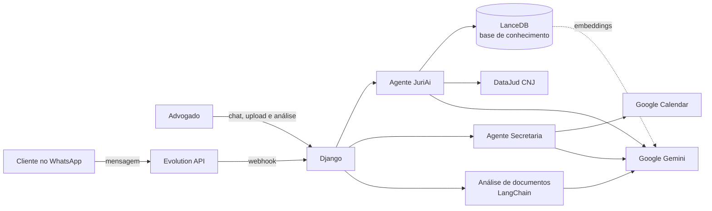

# ⚖️ JuriIA - Assistente Jurídico com Agentes Autônomos

O **JuriIA** é uma solução de automação jurídica inteligente desenvolvida para otimizar o atendimento ao cliente e a gestão de processos. O sistema utiliza Inteligência Artificial (LLMs) com a metodologia **RAG (Retrieval-Augmented Generation)** para fornecer respostas precisas sobre a empresa e **Agentes Autônomos** para interagir com ferramentas externas, como o Google Calendar.

▶️ **[Vídeo de apresentação e teste do projeto](https://youtu.be/ynSrh_bMNk8)**

> ⚠️ Projeto de estudo e portfólio. Os documentos de exemplo são **fictícios** e a IA não substitui a revisão de um(a) advogado(a). Veja as [limitações conhecidas](#-limitações-conhecidas).

---

## 🚀 Principais Funcionalidades

* **Atendimento Jurídico Inteligente**: Responde dúvidas sobre produtos, serviços e políticas com base em documentos da empresa (RAG).
* **Chat com fontes**: o assistente consulta os documentos enviados e mostra os trechos usados na resposta ("Confira as fontes").
* **Análise de documentos**: gera um índice de risco (0 a 100), classificação e listas de erros de coerência, riscos jurídicos, problemas de formatação e *red flags* a partir de uma peça enviada.
* **Agendamento Autônomo**: Integração nativa com o Google Calendar para verificar disponibilidade e criar reuniões entre 13h e 18h.
* **Consulta Processual**: Busca automatizada de dados de processos judiciais na API pública do **DataJud (CNJ)**.
* **Memória de sessão**: o histórico das conversas fica salvo em banco de dados e é reaproveitado pelos agentes.
* **Canal WhatsApp** (via Evolution API): o webhook recebe a mensagem e a encaminha ao agente de secretaria. Requer uma instância própria da Evolution API.

---

## 🛠️ Tecnologias Utilizadas

* **Linguagem**: Python 3.12.6 (recomendamos o uso de um ambiente virtual (venv) para isolar as dependências)
* **Framework**: Django
* **IA & Agentes**: Agno (agentes com *tools*), LangChain (análise estruturada) & Google Gemini (LLM)
* **Vetorização (RAG)**: LanceDB & Gemini Embeddings
* **APIs**: Google Calendar API, DataJud (CNJ) & Evolution API (WhatsApp)
* **Front-end**: templates Django com Tailwind CSS
* **Banco de dados**: SQLite

---

## 📋 Como Instalar e Rodar

1. **Clone o repositório:**
   ```bash
   git clone https://github.com/AntonioPROLucas/Projeto_JuriIA.git
   cd Projeto_JuriIA
   ```

2. **Crie e ative o ambiente virtual:**
   ```bash
   python -m venv venv
   source venv/bin/activate   # No Windows: venv\Scripts\activate
   ```

3. **Instale as dependências:**
   ```bash
   pip install -r requirements.txt
   ```

4. **Configure as variáveis de ambiente:**
   Copie o modelo e preencha com as suas chaves (veja a tabela abaixo):
   ```bash
   cp .env.example .env       # No Windows: copy .env.example .env
   ```

5. **Prepare o banco de dados:**
   ```bash
   python manage.py migrate
   ```

6. **Execute o servidor:**
   ```bash
   python manage.py runserver
   ```
   Acesse `http://127.0.0.1:8000/`.

### Variáveis de ambiente

| Variável | Para que serve | Obrigatória |
|---|---|---|
| `GOOGLE_API_KEY` | Chave do Google Gemini (LLM e embeddings). Gere no [Google AI Studio](https://aistudio.google.com/) | Sim |
| `SECRET_KEY` | Chave secreta do Django. Gere com `python -c "from django.core.management.utils import get_random_secret_key; print(get_random_secret_key())"` | Sim |
| `DEBUG` | `True` para desenvolvimento local | Não (padrão `False`) |
| `ALLOWED_HOSTS` | Hosts permitidos, separados por vírgula | Não (padrão `localhost,127.0.0.1`) |
| `DATAJUD_API_KEY` | Chave de acesso à API pública do DataJud (disponível na documentação oficial do CNJ) | Para a consulta processual |
| `EVOLUTION_BASE_URL` | URL da sua instância da Evolution API | Só para o WhatsApp |
| `EVOLUTION_API_KEY` | Chave da sua instância da Evolution API | Só para o WhatsApp |
| `EVOLUTION_INSTANCE` | Nome da instância configurada | Só para o WhatsApp |

### Google Calendar

O agendamento usa credenciais OAuth do Google. Crie um projeto no Google Cloud, ative a **Google Calendar API**, gere as credenciais de aplicativo (OAuth) e salve o arquivo como `credentials.json` **na raiz do projeto**. Na primeira execução, o Google pede a autorização e gera o `token.json`. Os dois arquivos estão no `.gitignore` e **nunca devem ser enviados ao GitHub**.

### Testando com o documento de exemplo

1. Crie uma conta e faça login.
2. Cadastre um cliente.
3. Na página do cliente, envie o PDF `exemplos/caso_teste_juridico.pdf` (documento **fictício**).
4. Abra o **Chat** do cliente e pergunte sobre o documento, por exemplo: *"Faça um resumo dos fatos da petição"*.
5. Clique em **"Confira as fontes"** para ver os trechos que a IA usou.
6. Abra a **análise** do documento e clique em **"Analisar Documento"** para gerar o índice de risco.

---

## 🏗️ Arquitetura do Sistema

O sistema foi desenhado para separar a camada de conhecimento (documentos) da camada de execução (agentes), garantindo que a IA consulte sempre a base de dados antes de realizar qualquer ação externa.



* **`usuarios/`**: cadastro, login, clientes e upload de documentos.
* **`ia/`**: agentes (`agents.py`), análise estruturada (`agent_langchain.py`), integração com o WhatsApp (`wrapper_evolution_api.py`) e as telas de chat, fontes e análise.
* **`core/`**: configurações do projeto Django.
* **`exemplos/`**: documento fictício para demonstração.

---

## 🙌 Origem e contribuições

Este projeto parte de um curso, e a base (estrutura Django, análise jurisprudencial, RAG com fontes e consulta ao DataJud) vem dele. As partes abaixo são minhas:

* Migração de LLM, embeddings e agentes do ChatGPT para o **Google Gemini**
* Integração com o **Google Calendar** (conta no Google Cloud e credenciais próprias)
* Página inicial com acesso ao login e ao cadastro
* Caso jurídico fictício para demonstração, adaptado por mim
* Ajuste das instruções dos agentes e simulação do webhook com o Thunder Client
* Imagens da interface
* README, ADR e vídeo de apresentação

---

## ⚠️ Limitações conhecidas

Este é um projeto de estudo, pensado para rodar localmente. Antes de qualquer uso real, falta:

* **Autenticação e isolamento de dados**: as rotas de chat e de análise não exigem login, e a base de conhecimento (RAG) não separa os documentos por cliente.
* **Webhook do WhatsApp**: recebe e processa a mensagem, mas o envio da resposta ao cliente ainda está em ajuste e não valida a origem da requisição.
* **Instância própria da Evolution API**: sem ela, o canal WhatsApp não funciona.
* **Testes automatizados**: ainda não existem.

---

## 📐 ADR 001: Escolha da Abordagem de Integração

**Contexto:** Necessidade de conectar o WhatsApp ao sistema de IA com o menor custo operacional possível.

**Opção A (Middleware n8n):** Reduz o esforço de codificação, mas introduz custos operacionais (mensalidade) e latência de rede.

**Opção B (Integração Direta via Django):** Aumenta o esforço de codificação inicial e depende do adapter `wrapper_evolution_api` (baseado no código do curso) e de uma instância própria da Evolution API, mas evita a mensalidade de um middleware e reduz a latência.

**Decisão:** Opção B.

**Consequência:** O sistema está mais acoplado, porém o custo operacional é baixo (apenas a infraestrutura do servidor principal e da Evolution API) durante a fase de validação do produto.

---

## 📝 Licença

Este projeto está sob a licença MIT. Sinta-se à vontade para utilizar, aprender e contribuir!
